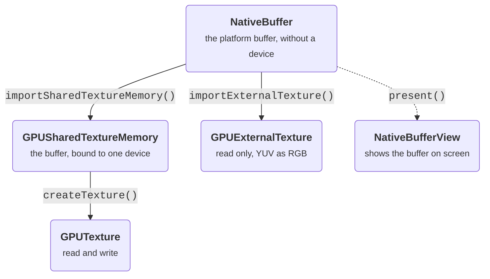

A [`NativeBuffer`](/api/native-buffer#nativebuffer) is an `AHardwareBuffer` on Android and an `IOSurface` on Apple platforms.

It does not belong to any GPU device: any GPU API can write it or read it, and a [`NativeBufferView`](/api/native-buffer#nativebufferview) can display it, without copies or CPU readbacks.
Since each of them works asynchronously on the GPU, every handoff comes with a [fence](#synchronization) that signals when the previous user is done with the buffer.

This page shows how these pieces fit together.
The [Native Buffer](/api/native-buffer) and [Native Extensions](/api/gpu-device-extensions) API pages document each call in detail.

## The flow

A device uses a buffer in one of two ways: as a `GPUTexture` to read and write, or as a `GPUExternalTexture` to read only.



1. **[`NativeBuffer`](/api/native-buffer#nativebuffer)** is the buffer itself, with its size, its pixel format and `release()`. A camera, a video decoder or `createNativeBuffer()` produces it, and it works without any device.
2. **[`GPUSharedTextureMemory`](/api/gpu-device-extensions#importsharedtexturememory)** is the buffer bound to a device: Dawn's import of it. A buffer is imported once per device, and stays imported for as long as you use it.
3. **`GPUTexture`** is what `memory.createTexture()` returns: a regular WebGPU texture whose pixels are the buffer's, no copy involved. It is **read and write**: render into it, sample it, copy from it. It is used only inside an **access window**: between `memory.beginAccess()` and `memory.endAccess()`, the device owns the buffer.
4. **[`GPUExternalTexture`](/api/gpu-device-extensions#gpuexternaltexture-extensions)** comes from the WebGPU specification, where it samples a video frame. It is **read only**: it converts YUV to RGB while sampling, with the frame's rotation and mirroring applied, and it is the only way to read a camera or video frame in a YUV format. `importExternalTexture({ source: buffer })` imports the buffer for this one frame and releases it when you destroy the external texture.

To read every frame of a camera or a decoder without importing its buffers again each time, an external texture can also be built over a texture of a shared memory; see [Importing a buffer once](/api/gpu-device-extensions#importing-a-buffer-once).

Two more types sit next to the flow:

- **[`GPUSharedFence`](/api/gpu-device-extensions#importsharedfence)** says when some GPU work on the buffer is done (a sync fd on Android, an `MTLSharedEvent` on Apple platforms). `memory.endAccess()` returns the fences of the access, so the next user, another API or the screen, can wait for them.
- **[`NativeBufferView`](/api/native-buffer#nativebufferview)** displays a buffer as a React Native view. It has no swap chain and no device of its own.

## Where buffers come from

**Your own rendering.** [`createNativeBuffer()`](/api/native-buffer#createnativebuffer) allocates an empty color buffer that WebGPU or Skia renders into, for instance to display it in a `NativeBufferView` (see [Rendering into a buffer](#rendering-into-a-buffer)).
The [200 icons example](https://github.com/wcandillon/react-native-webgpu/blob/main/apps/example/src/IconBenchmark/IconBenchmark.tsx) draws each icon with Skia into a buffer of its own and compares it with one Skia `<Canvas>` per icon.

**Cameras.** [VisionCamera](/docs/integrations/vision-camera) exposes each frame's buffer as its own `NativeBuffer` (the same name, and the same idea): [`createVideoFrameFromNativeBuffer()`](/api/native-buffer#createvideoframefromnativebuffer) wraps its pointer into ours.

**Video.** [React Native Skia Video](https://github.com/AzzappApp/react-native-skia-video) decodes and encodes video with Skia, and its [React Native Skia v3 version](https://github.com/AzzappApp/react-native-skia-video/pull/63) moves frames between the platform decoders and encoders and Skia through React Native WebGPU, without CPU copies.

Camera and video frames come from a **pool**: the producer writes the next frames into the same few buffers, and gets a buffer back once you release its frame.
Release pooled frames as soon as the GPU work that reads them has been submitted; a producer that runs out of buffers stops delivering frames.
A buffer you allocate yourself stays yours until you release it.

## Reading a buffer on the GPU

| You want to | Use |
| --- | --- |
| Sample a frame in your shader, YUV included | [`importExternalTexture({ source: buffer })`](/api/gpu-device-extensions#gpuexternaltexture-extensions) |
| Do the same for every frame of a camera or a decoder, importing each buffer once | [`importSharedTextureMemory()`](/api/gpu-device-extensions#importing-a-buffer-once), then `importExternalTexture({ source: texture })` |
| Use a color buffer as a regular texture, without a copy | [`importSharedTextureMemory()`](/api/gpu-device-extensions#importsharedtexturememory), then `memory.createTexture()` |
| Keep a copy of the frame in a texture of your own | [`copyExternalImageToTexture()`](/api/gpu-device-extensions#copyexternalimagetotexture-with-a-native-frame) |

The copy runs on the GPU, so the frame can be released right after; it is the path to hand a frame to a library that wants a texture it owns, such as Skia or Three.js.

```tsx twoslash
import type { NativeBuffer } from "react-native-webgpu";
declare const device: GPUDevice;
declare const frame: NativeBuffer;
declare const rotation: 0 | 90 | 180 | 270;
declare function draw(texture: GPUExternalTexture): void;
// ---cut---
// A frame from a camera or a video decoder
const texture = device.importExternalTexture({ source: frame, rotation });
draw(texture); // ...and queue.submit()
texture.destroy();
frame.release(); // the producer can reuse the buffer
```

## Rendering into a buffer

Allocate a buffer with `createNativeBuffer()`, import it with `importSharedTextureMemory()`, and render into its texture inside an access window:

```tsx twoslash
import { createNativeBuffer } from "react-native-webgpu";
declare const device: GPUDevice;
declare function render(texture: GPUTexture): void;
// ---cut---
const frame = createNativeBuffer(512, 512);
const memory = device.importSharedTextureMemory({ source: frame });
const texture = memory.createTexture();

// false: a new buffer, nothing in it to keep
memory.beginAccess(texture, false);
render(texture); // encode passes into the texture and submit
// The fences signal once the GPU has finished writing the buffer
const done = memory.endAccess(texture);
```

The work is only queued when `endAccess()` returns: whoever reads the buffer next (the screen, another device, a native library) has to wait for its fences first.
[`NativeBufferView`](#displaying-a-buffer) takes them as they are, with `present(frame, done)`.

### Drawing with Skia

When React Native Skia shares its device with React Native WebGPU (see [Rendering with Skia's device](/docs/integrations/react-native-skia#rendering-with-skias-device)), Skia can draw straight into a native buffer:

```tsx
import { Skia } from "react-native-skia";
import { createNativeBuffer, importDevice } from "react-native-webgpu";

const device = importDevice(Skia.getNativeDevice());

const frame = createNativeBuffer(width, height);
const memory = device.importSharedTextureMemory({ source: frame });
const texture = memory.createTexture();
memory.beginAccess(texture, false);
const surface = Skia.Surface.MakeFromGPUTexture(texture);
const canvas = surface.getCanvas();
canvas.drawPicture(picture);
// Submit Skia's commands before the access ends
surface.flush();

viewRef.current.present(frame, memory.endAccess(texture));
surface.dispose();
texture.destroy();
memory.destroy();
frame.release();
```

## Displaying a buffer

[`NativeBufferView`](/api/native-buffer#nativebufferview) shows a buffer as a regular React Native view.
It reports its size in physical pixels, and you present a buffer of that size through its ref:

```tsx twoslash
import React, { useEffect, useRef } from "react";
import {
  createNativeBuffer,
  NativeBufferView,
  useNativeBufferSize,
  type NativeBufferViewRef,
} from "react-native-webgpu";
declare const device: GPUDevice;
declare function render(texture: GPUTexture): void;
// ---cut---
export const Thumbnail = () => {
  const ref = useRef<NativeBufferViewRef>(null);
  const { size, onPixelSizeChange } = useNativeBufferSize();

  useEffect(() => {
    if (!size || !ref.current) {
      return;
    }
    const frame = createNativeBuffer(size.width, size.height);
    const memory = device.importSharedTextureMemory({ source: frame });
    const texture = memory.createTexture();
    memory.beginAccess(texture, false);
    render(texture);
    // Shown once the GPU work is done. The view keeps its own reference on
    // the buffer and on the fences.
    ref.current.present(frame, memory.endAccess(texture));
    texture.destroy();
    memory.destroy();
    frame.release();
  }, [size]);

  return (
    <NativeBufferView
      ref={ref}
      onPixelSizeChange={onPixelSizeChange}
      style={{ width: 96, height: 96 }}
    />
  );
};
```

`present()` returns right away. The view waits for the fence off the main thread and shows the buffer on the next vsync after it signals.
Until the producer catches up with a resize, the view scales the buffer it has according to its [`resizeMode`](/api/native-buffer#resize-modes).

### NativeBufferView or Canvas?

A [`Canvas`](/api/canvas) has a swap chain: a few buffers it cycles through to show a new frame on every vsync.
A `NativeBufferView` holds a single buffer, the last one presented.
That makes it the better fit for content that is drawn once or updated now and then, such as icons, thumbnails, a chart or a filtered photo, especially when a screen has many of them.
Animated content belongs in a `Canvas`.

### Never write a displayed buffer

The view reads the buffer whenever the system composites the screen, so a buffer must not be written again once it has been presented.
Render each update into a new buffer and present that one. The view keeps its own reference on the buffer, so a buffer from `createNativeBuffer()` can be released right after `present()`.

A **pooled** frame, from a camera or a video decoder, breaks this rule on its own: its producer writes a later frame into the buffer as soon as the frame is released, even while the view still shows it.
Copy such a frame into a buffer of your own and present the copy:

```tsx twoslash
import {
  createNativeBuffer,
  type NativeBuffer,
  type NativeBufferViewRef,
} from "react-native-webgpu";
declare const device: GPUDevice;
declare const frame: NativeBuffer;
declare const view: NativeBufferViewRef;
// ---cut---
const copy = createNativeBuffer(frame.width, frame.height);
const memory = device.importSharedTextureMemory({ source: copy });
const texture = memory.createTexture();
memory.beginAccess(texture, false);
device.queue.copyExternalImageToTexture(
  { source: frame },
  { texture },
  [frame.width, frame.height],
);
const done = memory.endAccess(texture);
frame.release(); // back to the decoder or the camera
view.present(copy, done);
texture.destroy();
memory.destroy();
copy.release();
```

### Presenting from a worklet

`ref.current.viewId` identifies the view on any runtime.
On a worklet runtime, such as a frame processor or a Reanimated worklet, present with the `RNWebGPU` global, which the worklet captures:

```tsx
RNWebGPU.presentNativeBuffer(viewId, frame, memory.endAccess(texture));
```

## Synchronization

GPU work is asynchronous, so each handoff of a buffer comes with a fence that says when the previous user is done with it.

- **From the producer to your device.** On Android, a frame carries `acquireFenceFd`: the decoder or the camera signals it once the buffer is written. `importExternalTexture()`, `copyExternalImageToTexture()` and `present()` wait for it on their own. With `importSharedTextureMemory()`, pass it to `beginAccess()` once you import it with `importSharedFence({ type: "sync-fd", handle: frame.acquireFenceFd })`; see [Importing a buffer once](/api/gpu-device-extensions#importing-a-buffer-once). On Apple platforms, frames are complete when you receive them.
- **From your device to the next user.** `endAccess()` returns the fences that signal once the work submitted in the access is done. Pass the result to `present()`, export each fence to a native consumer with `fence.export()`, or destroy them.
- **Inside the access window.** A texture created from a buffer can only be used between `beginAccess()` and `endAccess()`, and only one access can be open on a buffer at a time.

`beginAccess()` and `present()` take their own reference on the fences they are given, so you can destroy a fence right after passing it.

## Lifetimes

| Object | Keeps alive | Release with |
| --- | --- | --- |
| `NativeBuffer` | The platform buffer | `release()`, or garbage collection. Release pooled frames as soon as the GPU work that reads them is submitted. |
| `GPUSharedTextureMemory` | The import, and the `NativeBuffer` it was imported from | `destroy()`, after `endAccess()` and after destroying its textures |
| `GPUTexture` of a memory | The texture over the buffer | `destroy()`, before the memory |
| `GPUSharedFence` | The native fence | `destroy()`, once it has been handed to `beginAccess()` or `present()` |
| `GPUExternalTexture` | Its access to the frame (with a frame as the source) | `destroy()`, after the `queue.submit()` that sampled it |
| `NativeBufferView` | The last buffer presented | Replaced by the next `present()`, released on unmount and on reload |

Garbage collection eventually releases all of these, but it can run long after the object is unreachable. A runtime that imports a buffer per frame should release eagerly.

## Devices

`requestDevice()` enables the Dawn features behind native buffers whenever the adapter supports them, so nothing has to be requested.
A device created by another library and wrapped with [`importDevice()`](/docs/getting-started/native-api#importing-an-external-device) has to request them itself, as React Native Skia's device does:

| Platform | Features |
| --- | --- |
| iOS, macOS | `shared-texture-memory-iosurface`, `shared-fence-mtl-shared-event`, `dawn-multi-planar-formats` |
| Android | `shared-texture-memory-ahardware-buffer`, `shared-fence-sync-fd`, `opaque-ycbcr-android-for-external-texture` |

On the rare drivers and emulators that cannot import native buffers, the import throws an error naming what is missing. Catch it to degrade.

## Platform notes

- **YUV on Android.** The video decoder and the camera produce YUV buffers in a layout only the driver knows. Read them through an external texture (over the frame, or over a texture of its shared memory) or with `copyExternalImageToTexture()`.
- **BGRA on Apple platforms.** BGRA frames also import as regular textures through `importSharedTextureMemory()`.
- **Android 8 and 9.** `NativeBufferView` copies the pixels of each buffer it is given through the CPU. From Android 10 on, it shows the buffer without a copy.
- **High bit depth.** A `createNativeBuffer()` buffer in `rgba16float` gives more precision, not extended range: `NativeBufferView` shows values in [0, 1] and clamps the rest.

## Examples

- [NativeBufferView](https://github.com/wcandillon/react-native-webgpu/blob/main/apps/example/src/NativeBufferView/NativeBufferView.tsx): renders into a buffer of the view's size and re-renders when the view is resized
- [200 icons](https://github.com/wcandillon/react-native-webgpu/blob/main/apps/example/src/IconBenchmark/IconBenchmark.tsx): Skia draws 200 icons into native buffers displayed by `NativeBufferView`s, compared with one Skia `<Canvas>` per icon
- [Vision Camera](/docs/integrations/vision-camera): WGSL effects on live camera frames
